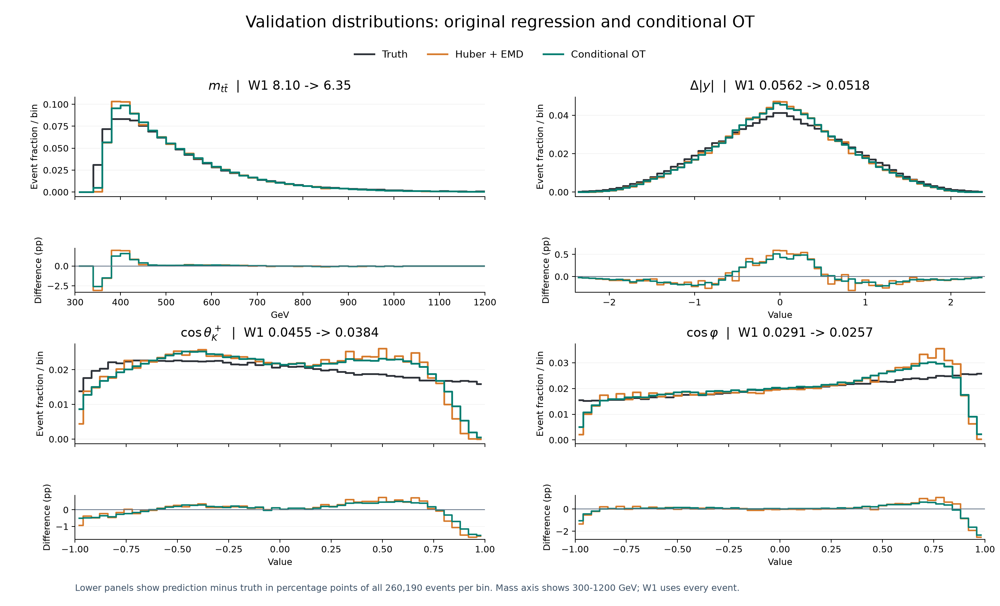

# Dileptonic top-pair reconstruction studies

Code and experimental records for reconstructing four observables in dileptonic
top-pair events: $m_{t\bar t}$, $\Delta|y|$, $\cos\theta_K^+$ and $\cos\varphi$.
The studies build on [HepSetReg](https://github.com/els285/HepSetReg/tree/bsc)
and include comparisons with [VyPER](https://github.com/tzuhanchang/VyPER).

The main result is a small correction network trained on a frozen regression
model with **conditional projected distribution matching (COT)**. It groups
events by the original predicted mass, then compares the joint prediction and
truth distributions through sorted one-dimensional projections.

## Start here

| Contents | Location |
|---|---|
| Reusable COT loss and group metadata | [`src/ttbar_reco`](src/ttbar_reco) |
| Mathematical definition and integration | [`docs/conditional_ot.md`](docs/conditional_ot.md) |
| All experimental methods and how the runs connect | [`docs/experiments.md`](docs/experiments.md) |
| Historical training, evaluation and plotting scripts | [`experiments`](experiments) |
| Parameters for the recorded sweeps | [`configs`](configs) |
| COT literature and BibTeX | [`docs/references.md`](docs/references.md), [`references.bib`](references.bib) |
| Numerical results and figures | [`results`](results), [`figures`](figures) |
| Data and checkpoint requirements | [`docs/data.md`](docs/data.md) |

The archive covers Transformer/ParT hyperparameters, regression and distribution
losses, high-mass gating, Gaussian and flow heads, prediction mixing, migration
and adaptive robust losses, expert mixtures, auxiliary reconstruction, COT,
metric constraints, RankSim and FlowAlign. The method index distinguishes a
recorded experiment from a portable entry point.

## Run the small COT example

```bash
python -m pip install -e ".[test]"
python examples/cot_minimal.py
python -m pytest
```

The example uses synthetic events and runs on CPU. Historical full-data training
requires the separate event files, fitted training statistics, frozen baseline
and compatible HepSetReg environment described in the method index.

## Recorded comparison

Against the frozen Huber + 0.1 EMD baseline, the selected COT correction improved
the residual width by about 0.48–0.99% and the mean migration diagonal by
0.23–0.68 percentage points across the four observables. The geometric mean of
the four marginal Wasserstein-error ratios fell by 14.36%.

These numbers describe the recorded 260,190-event validation comparison, using
one seed and validation checkpoint selection. The correction-only control also
improves several metrics, so the full change from the baseline is not solely an
effect of the COT penalty. See [`results/README.md`](results/README.md) for exact
values, metric definitions and the high-mass comparison.



## Code and references

The COT implementation uses a grouped sliced-Wasserstein squared penalty; it is
not an implementation of a learned conditional Monge map. The grouping and
correction design are project choices. The references explain which part each
paper supports.

Upstream packages retain their own authorship and licences. The adapted RankSim
file retains its CC BY-NC-SA 4.0 notice. See [`LICENSE`](LICENSE) for the scope of
the MIT licence on the remaining original project code.
