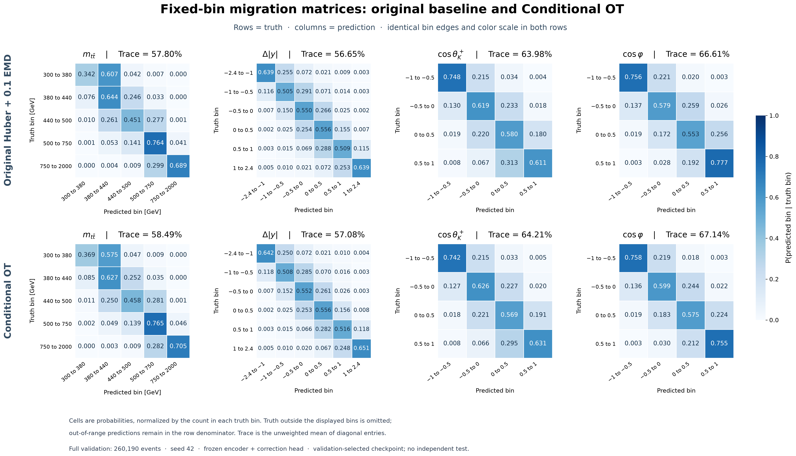

# Six-method correction comparison

All methods use the same 260,190 events and the same physical predictions for every metric.

| Observable | Baseline width | COT width | Baseline diagonal | COT diagonal | Baseline W1 | COT W1 |
|---|---:|---:|---:|---:|---:|---:|
| ttbar_mass | 102.383124 | 101.896893 | 0.578032 | 0.584860 | 8.096885 | 6.352061 |
| delta_abs_y | 0.644709 | 0.640855 | 0.566475 | 0.570795 | 0.056207 | 0.051767 |
| cos_K_plus | 0.490891 | 0.486015 | 0.639771 | 0.642059 | 0.045504 | 0.038359 |
| cos_phi | 0.462561 | 0.458131 | 0.666093 | 0.671406 | 0.029133 | 0.025728 |

Mass width and W1 are in GeV; the other observables are dimensionless.

| Correction method | Mean width improvement (%) | Mean diagonal improvement (pp) | Geometric W1 reduction (%) |
|---|---:|---:|---:|
| conditional_ot | 0.756 | 0.469 | 14.360 |
| conditional_ot_proxy | 0.990 | 0.492 | 12.506 |
| correction_control | 0.797 | 0.397 | 5.757 |
| flowalign | 0.786 | 0.405 | 5.240 |
| ranksim | 0.082 | 0.127 | 4.527 |
| proxy_constraints | 0.954 | 0.415 | 4.035 |

The ranking first requires all four widths and all four mean diagonals to be no worse than the baseline, then minimises the geometric mean of the four W1 ratios. These are selection rules, not a claim of significance.

## Metric definitions

For event residuals $e_i=\hat y_i-y_i$, the width is $Q_{0.8413}(e)-Q_{0.1587}(e)$ (the full central width, not its half-width). Quantiles use linear interpolation.

The migration entry is $M_{ab}=N(y\in B_a,\hat y\in B_b)/N(y\in B_a)$. The reported diagonal score is the unweighted mean of its diagonal entries. Predictions outside the plotted range remain in the denominator, so a row may sum to less than one. Truth values outside the range are counted separately. NumPy histograms include the rightmost edge in the last bin.

The marginal distribution error is $W_1=N^{-1}\sum_i|\hat y_{(i)}-y_{(i)}|$, with each list sorted separately. The combined reduction is $100[1-\exp(\frac14\sum_j\log(W_{1,j}/W_{1,j}^{base}))]$. This is distinct from the squared joint projection penalty used in training.

## Scope and tail behaviour

These are one-seed, validation-selected correction-head results. The baseline encoder is frozen. The correction-only control provides the comparison needed to separate adding a head from adding COT. Relative to the original baseline, COT worsens mass width above truth mass 800/1000 GeV by about 1.96%/3.22%; the positive-helicity and opening-angle cosine out-of-range counts rise from 11/5 to 358/174. Overall improvements therefore do not establish uniform improvements in every region or superiority to a paper under matched conditions.

The aggregate JSON preserves the fixed bin edges, row counts and matrices. The original analysis scripts are in `experiments/methods_sweep_20261112`.

